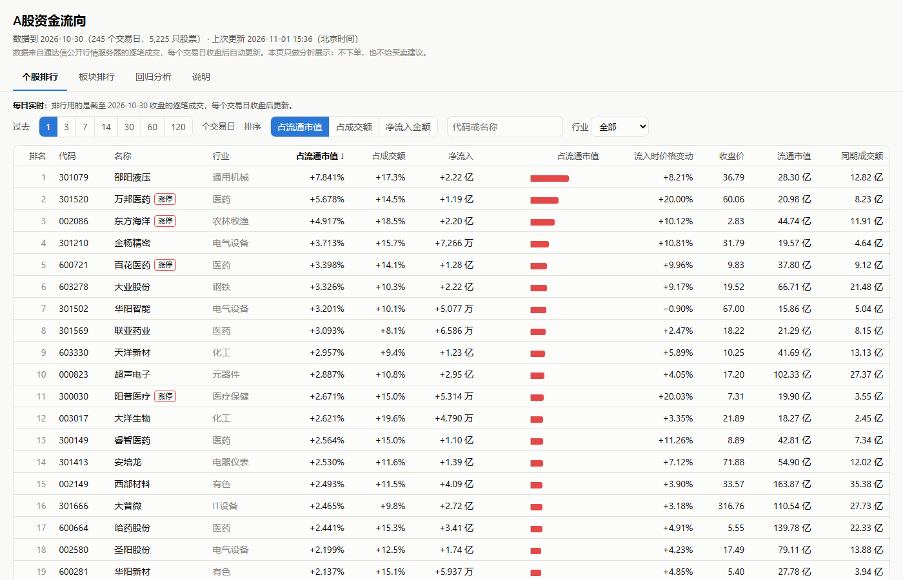
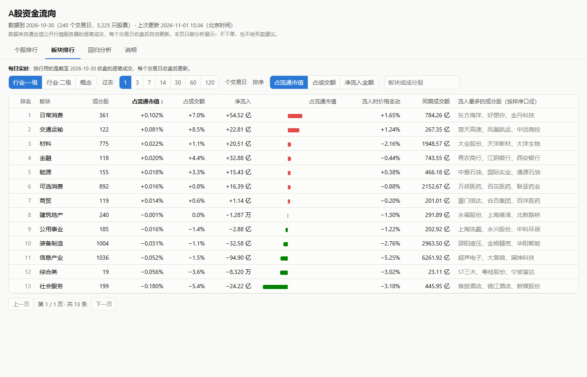
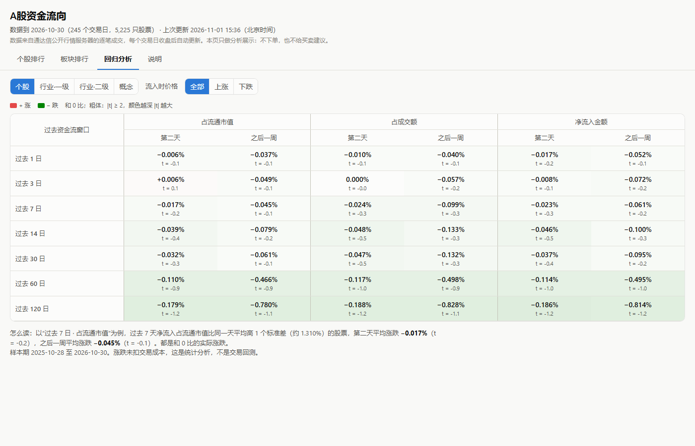

# A股资金流向 · 使用指南

这个程序每天告诉你沪深 A 股里哪些股票、哪些板块在过去 1 到 120 个交易日资金净流入最多，并用一年的数据检验：资金流入多的股票，之后是涨还是跌。

它只做分析展示：不需要登录，不连券商，不下单，也不给买卖建议。

---

## 一、下载和打开

1. 打开下载页：**https://github.com/jerry2411111/cn_flow/releases/latest**
2. 在页面下方的 **Assets** 里点 **`cn_flow-windows.zip`** 下载（约 14 MB）。
3. 右键压缩包，选“全部解压缩”，解压到**桌面**或**文档**这类普通文件夹。
   - 不要在压缩包里直接双击运行。
   - 不要放进 `C:\Program Files`：程序要在自己旁边保存下载的结果。
4. 打开解压出来的 `cn_flow` 文件夹，双击 **`cn_flow.exe`**。
5. 第一次打开时，Windows 可能提示“Windows 已保护你的电脑”。这是因为程序没有付费的数字签名：点“**更多信息**”，再点“**仍要运行**”。

第一次打开时，程序会自动下载最新结果（约 3 MB），几秒钟后表格就会出现。

**想在桌面放一个图标：** 右键 `cn_flow.exe`，选“发送到”，再选“桌面快捷方式”。

**电脑要求：**
- Windows 10 或 11（64 位），能上网。
- Edge WebView2：Windows 11 自带，Windows 10 一般也已随 Edge 浏览器装好。如果打开后是白屏，见下面的[常见问题](#六常见问题)。

---

## 二、数据什么时候更新

- 每个交易日收盘后，大约**北京时间 17:30**，系统会自动取当天全部沪深 A 股的逐笔成交，重新计算排行和回归。GitHub 偶尔会晚 10 到 60 分钟。
- 程序开着时，每 20 分钟检查一次有没有新结果，有就自动下载，页面一分钟内自动刷新，不用做任何操作。
- 页面顶部的“**数据到 2026-10-30**”就是最近一个交易日。
- 排行用的是收盘后完整的逐笔成交，所以**盘中数字不变**。周末和节假日没有新数据。
- 历史数据不用下载：程序只下载算好的结果。

---

## 三、个股排行

**怎么用：**

| 控件 | 作用 |
|---|---|
| 过去 1 / 3 / 7 / 14 / 30 / 60 / 120 个交易日 | 资金流统计多少天 |
| 排序：占流通市值 / 占成交额 / 净流入金额 | 按哪种口径排名（默认占流通市值） |
| 点表头 | 按这一列排序，再点一次反过来 |
| 搜索框 | 输入代码或名称，比如 `600519` 或 `茅台` |
| 行业 | 只看某个行业 |
| 上一页 / 下一页 | 每页 100 只 |

**每一列的意思：**

| 列 | 意思 |
|---|---|
| **占流通市值** | 过去 N 天的净流入 ÷ 流通市值。股票大小不同时，用它比较最公平 |
| **占成交额** | 净流入 ÷ 同期成交额：成交里有多大比例是主动买入多出来的 |
| **净流入** | 主动买入金额 − 主动卖出金额。大盘股天然更大，所以不适合直接比大小 |
| 条形 | 当前排序口径的大小：红色是流入，绿色是流出 |
| **流入时价格变动** | 同样这 N 天里的涨跌（已复权） |
| 收盘价、流通市值、同期成交额 | 最后一天的收盘价、流通市值，以及这 N 天的成交额 |
| 涨停 / 跌停 标签 | 最后一天收在涨停或跌停 |

**例子：** 上图第 1 行，邵阳液压过去 1 天净流入 2.22 亿，占流通市值 7.841%，占成交额 17.3%，当天涨 8.21%。

---

## 四、板块排行

- 左上角选板块类型：**行业·一级**、**行业·二级**（通达信行业分类），或者**概念**。
- 板块的净流入是全部成分股加起来；占流通市值用板块的总流通市值算；涨跌是成分股按流通市值加权。
- 最后一列“**流入最多的成分股**”：按当前排序口径，列出这个板块里流入最多的 3 只股票。
- 搜索框可以搜板块名，也可以搜成分股名，比如搜“茅台”，就能看到它属于哪些板块。

---

## 五、回归分析：资金流入后是涨是跌

它回答一个问题：**资金流入比别的股票多的股票，之后平均是涨还是跌？**

**怎么读一个格子：** 比如“过去 7 日 · 占流通市值 · 第二天”这一格：
- 上面的数字，是过去 7 天净流入比当天平均高 1 个标准差的股票，**第二天的平均实际涨跌**。它和 0 比，不和其他股票比。
- 下面的 t 值说明结果靠不靠得住：
  - |t| ≥ 2（显示为粗体）：统计上可信；
  - |t| < 2：和 0 分不开，也就是看不出规律。
- 颜色：红色是涨，绿色是跌，颜色越深 |t| 越大。
- 鼠标放在格子上，可以看到 1 个标准差相当于多少、用了多少天和多少只股票。

**上面的选项：**
- **个股 / 行业一级 / 行业二级 / 概念**：对股票做，还是对板块做。
- **流入时价格：全部 / 上涨 / 下跌**：只看流入那几天价格上涨的股票，或者只看下跌的。

**截至 2026-10-30 的结果（一年，245 个交易日）：**
- 个股的所有格子 |t| 都不到 1.5：资金流入多的股票，第二天和之后一周的涨跌**和 0 没有显著差别**。按流入时上涨或下跌分开看，也一样。
- 60 天、120 天两行偏负（约 −0.1% 到 −0.8%），是因为那段时间大盘本身在跌，所有股票都跌，不是资金流入造成的。

结果每天随新数据更新，以程序里显示的为准。

**注意：** 这里的涨跌没有扣交易成本，也包含大盘自己的涨跌。这是统计分析，不是交易回测，也不是投资建议。

---

## 六、常见问题

**状态栏显示“连不上 GitHub”**
检查网络。国内网络访问 GitHub 可能慢或者不稳定，程序会自动重试：已经有数据时每 20 分钟一次，还没有数据时每分钟一次。已经下载的数据照样可以看。

**打开后表格是空的**
第一次需要下载约 3 MB，通常几秒钟。如果一直是空的，看顶部状态栏的提示，多半是网络连不上 GitHub。

**白屏，或者窗口打不开**
从微软官网安装 WebView2 运行库：https://developer.microsoft.com/microsoft-edge/webview2/ （选 “Evergreen Bootstrapper”），装完再打开。如果还不行，把 `cn_flow` 文件夹里 `logs\app_error.log` 的内容发到本仓库的 [Issues](https://github.com/jerry2411111/cn_flow/issues)。

**双击没反应**
程序可能已经开着：再双击只会把已经打开的窗口调到前面。看一下任务栏。

**怎么升级**
下载新版本的 zip，解压后覆盖原来的文件夹。`results` 文件夹可以保留。

**怎么卸载**
直接删掉整个 `cn_flow` 文件夹。程序不改注册表，也不装后台服务。

**安全吗？会不会动我的账户？**
不会。程序只连接 github.com 下载结果文件，不登录任何账户，不连券商，不下单。源代码全部公开在本仓库。

---

## 七、数据从哪来、怎么算

- **来源：** 通达信公开行情服务器的历史逐笔成交（交易所每 3 秒一次的成交快照）。范围是沪深 A 股，包括主板、创业板、科创板，不包括北交所。
- **主动买卖：** 每笔成交是主动买入还是主动卖出，用服务器给的标记，不用买卖价差，因为历史逐笔里没有当时的报价。集合竞价和盘后定价成交不算进资金流。
- **涨跌停：** 当天最高价是涨停价时，涨停价上的成交不算进净流入，因为封板时的成交都会被标成“主动卖”。跌停同理。
- **涨跌：** 按分红、送转、配股复权。

更详细的定义，见程序里的“**说明**”页，或者 [README](README.md)。
